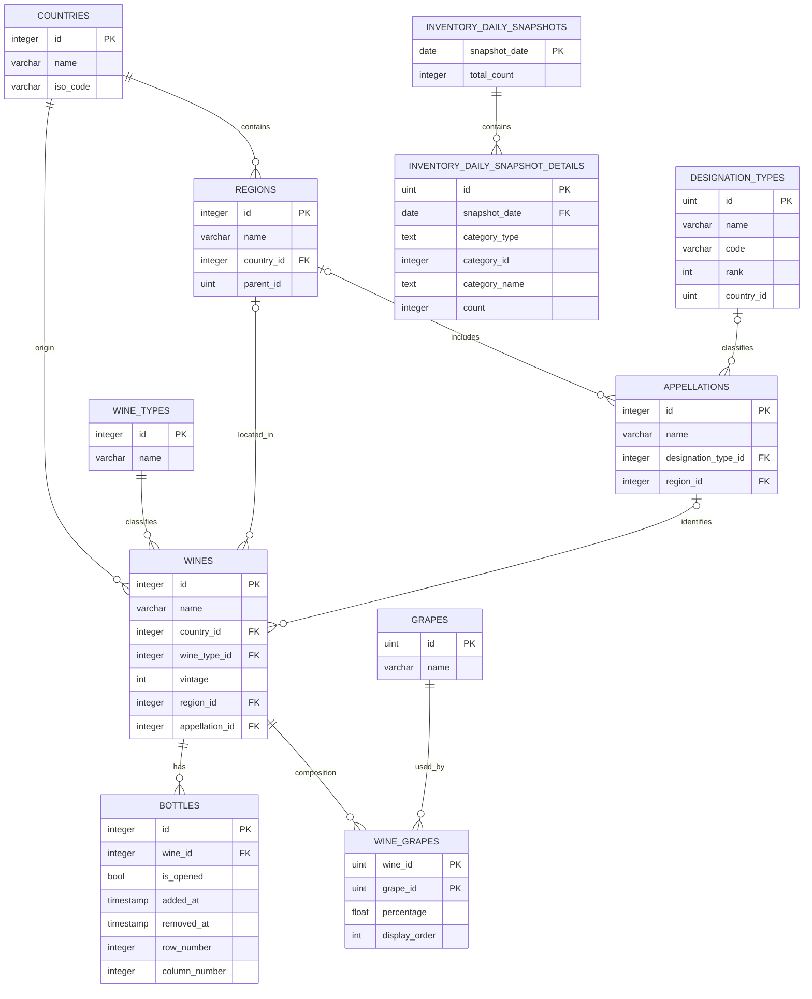

# データモデル

## 基準と対象範囲

本書はバックエンドの GORM 永続化モデル `cellar-app-backend/model/model.go` と `cellar-app-backend/database/migrate.go` を基準に、エンティティとデータの関係を説明します。カラムの詳細とコード上の型・NULL・制約は[データディクショナリ](./data-dictionary.md)、API の入出力構造は `cellar-app-backend/dto/dto.go` を参照してください。

本書はモデル定義を基準に記載し、2026-10-13 に確認した実 DB との差分のみを「実 DB との差分」節に記載します。同節に記載のない対象項目は、確認した `cellar_app.public` の状態とモデル定義が整合していました。確認結果は当該 DB・当該時点に限られ、他環境や将来のスキーマを保証するものではありません。

## 全体像

ER 図はモデル定義を基準にした図です。実 DB にのみ存在する関連は「実 DB との差分」に記載しています。

## テーブルの責務

| テーブル | 役割 | 関連の要点 |
|---|---|---|
| `countries` | 国マスター | 地域とワインの必須参照先 |
| `wine_types` | ワイン種別マスター | ワインの必須参照先 |
| `designation_types` | 呼称・格付け種別マスター | アペラシオンから任意参照 |
| `regions` | 国に属する地域 | 国を必須参照。`parent_id` による階層値を保持 |
| `appellations` | 地域に関連付ける呼称 | 地域と呼称種別をそれぞれ任意参照 |
| `wines` | ワインそのものの情報 | 国とワイン種別を必須参照。地域とアペラシオンは任意 |
| `bottles` | 個々のボトル・セラー在庫 | ワインを必須参照。位置、開封、入庫・除外情報を保持 |
| `grapes` | ブドウ品種マスター | `wine_grapes` 経由でワインと関連 |
| `wine_grapes` | ワインと品種の関連・構成 | `(wine_id, grape_id)` が複合主キー。割合・表示順を保持 |
| `inventory_daily_snapshots` | 日付ごとの在庫スナップショット | `snapshot_date` が主キー |
| `inventory_daily_snapshot_details` | スナップショットのカテゴリ別内訳 | スナップショット日付を参照。カテゴリは種別・国・ヴィンテージ |

## リレーション、所有、ライフサイクル

- **国―地域、国―ワイン、ワイン種別―ワイン:** いずれも1対多です。`regions.country_id`、`wines.country_id`、`wines.wine_type_id` は必須の FK としてモデルに定義されています。親の削除ポリシーは `NO ACTION` です。
- **地域―アペラシオン:** アペラシオンは地域を任意参照します。モデルの FK 削除ポリシーは `CASCADE` で、地域を削除すると関連するアペラシオンを削除する定義です。
- **呼称種別―アペラシオン:** アペラシオン側の参照は任意で、呼称種別削除時のポリシーは `SET NULL` です。
- **地域／アペラシオン―ワイン:** ワイン側の参照は任意です。地域参照は `NO ACTION`、アペラシオン参照は `SET NULL` です。ワインが地域・アペラシオンを所有している関係ではありません。
- **ワイン―ボトル:** 1対多です。ボトルはワイン ID を必須で持ち、明示された削除ポリシーは `CASCADE` です。ワイン削除によりボトルも削除されるモデル定義なので、通常の在庫除外は行削除でなく `removed_at` を設定する運用を優先してください。
- **ワイン―ブドウ品種:** 多対多です。`wine_grapes` が関連行と `percentage`、`display_order` を保持します。両側の関連と `GrapeID` の外部キーは GORM モデルにありますが、明示的な削除ポリシーはありません。
- **日次スナップショット―詳細:** 1対多です。詳細は親の日付を参照し、明示的な削除ポリシーは `CASCADE` です。再作成処理は同日の詳細を置き換えます。

### 実 DB との差分

2026-10-13 に利用者から共有された確認結果に基づく、`cellar_app.public`（PostgreSQL 17.6、`localhost:5432`）のモデルとの差分です。以下に挙げていない対象項目は、確認時点でモデル定義と整合していました。

| 対象 | 差分 |
|---|---|
| `regions.parent_id` | GORM モデルに自己参照関連がない一方、実 DB に `regions_parent_id_fkey` がある。参照先は `regions(id)`、削除動作は `NO ACTION`。 |
| `designation_types.country_id` | GORM モデルに Country 関連がない一方、実 DB に `designation_types_country_id_fkey` がある。参照先は `countries(id)`、削除動作は `CASCADE`。 |
| `wines` の列 | 現行モデルにない `grape_varieties`、`notes`、`label_image_path`、`quantity`、`price`、`is_favorite`、`created_at`、`updated_at` が実 DB に存在する。モデル外の列であり、未使用・削除対象とは推定しない。 |
| 物理型 | `wines.reference_price` と `wine_grapes.percentage` は実 DB で `numeric`。対応するモデルフィールドは Go `float64` で、DB 型を明示していない。`designation_types.id` は実 DB で `integer`（モデルは型タグなしの Go `uint`）。 |

### 削除時の扱い（モデル定義上）

| 削除するレコード | モデル上の結果 |
|---|---|
| Country | 地域またはワインが参照している場合は `NO ACTION` により削除できない |
| WineType | ワインが参照している場合は `NO ACTION` |
| Region | ワインが参照している場合は `NO ACTION`。地域のアペラシオンは `CASCADE` |
| DesignationType | 参照するアペラシオンの `designation_type_id` は `SET NULL` |
| Appellation | 参照するワインの `appellation_id` は `SET NULL` |
| Wine | 関連ボトルの `bottles` 行は `CASCADE` |
| Snapshot | 関連スナップショット詳細は `CASCADE` |

この表は GORM モデルに定義された関連の削除動作です。データ削除やスキーマ変更の前には、対象環境の制約と参照件数を改めて確認してください。

## データ整合性ルール

### モデルで定義されているもの

- ワイン名、国 ID、ワイン種別 ID、地域名・国 ID、アペラシオン名、国名、ワイン種別名、ブドウ名などの必須性・一意性。
- `wines.vintage` の CHECK 条件：1800 年以上、かつ実行時点の現在年以下。
- `inventory_daily_snapshot_details.category_type` の CHECK 条件：`wine_type`、`country`、`vintage` のいずれか。
- `regions` の `(name, parent_id)` 複合一意インデックス。
- `bottles` の `(row_number, column_number)` 複合一意インデックス。PostgreSQL の通常の UNIQUE では NULL を含む組が複数許可され得ます。部分一意インデックスのタグ指定はありません。
- スナップショット詳細には日付・カテゴリ検索用インデックスが定義されています。複合インデックスのグループ名は `idx_snapshot_details_category` です。

### アプリケーション側の検証と未定義事項

- 飲み頃開始・終了年の前後関係やボトル棚位置の範囲は handler で検証されるものがあります。これは DB CHECK ではありません。範囲や仕様を変更する場合は handler のテストと DB 制約の要否を合わせて検討してください。
- `percentage` の単位・合計値の扱い、`reference_price` の通貨・精度、棚番号の基点などはモデルだけでは確定できません。明確な仕様決定前に DB 制約や API 契約へ推測で追加しないでください。
- `is_opened` はモデル上 nullable pointer で、`false` の DB デフォルト指定があります。API DTO では bool となり、null と false の区別を保持しません。

関連するカラム定義は[データディクショナリ](./data-dictionary.md)、スキーマ変更手順は[スキーマ管理方針](./schema-management.md)と[DB運用手順](./database-operations.md)を参照してください。
